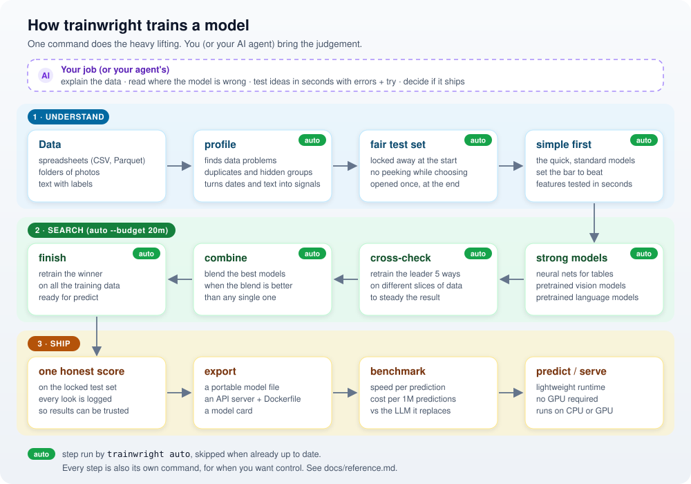

<h1 align="center">trainwright</h1>

<p align="center">
  <strong>Replace an expensive LLM call with a small model you own.</strong><br>
  Point it at labelled data. Get back a tested model and an API you can deploy.
</p>

<p align="center">
  <a href="https://github.com/djcopp/trainwright/actions/workflows/ci.yml"></a>
  
  <a href="LICENSE"></a>
</p>

<table align="center">
  <tr>
    <td align="center" width="200"><h2>14 of 22</h2>head-to-head wins against the same AI agent working without it</td>
    <td align="center" width="200"><h2>60% fewer</h2>mistakes at best<br>(satellite photos)</td>
    <td align="center" width="200"><h2>~800×</h2>cheaper per prediction than the LLM call it replaced (estimate)</td>
    <td align="center" width="200"><h2>1 command</h2>from a spreadsheet to a deployable model</td>
  </tr>
</table>

## Quick start

```bash
pip install "trainwright[all] @ git+https://github.com/djcopp/trainwright"

trainwright init --data tickets.csv --target category    # tables, image folders or text
trainwright auto --budget 20m                            # trains, checks and picks the best model
trainwright predict -i new_tickets.csv --out predictions.csv
trainwright export final                                 # an API server with a Dockerfile
```

## Or ask your coding agent

```bash
trainwright agent-setup    # teaches Claude Code (or any agent) how to use it
```

> *We tag support tickets with an LLM call today. `tickets.csv` has past tickets and their tags.
> Train a small model that could replace it, and tell me whether it's worth switching.*

## Results

The same request, given to the same agent (Claude Code) with and without trainwright. Each
model was scored on data the agent never saw.

| job | measure | without | with trainwright |
|---|---|---|---|
| Forecast hourly bike rentals | error ↓ | 40.2 | **36.0** |
| Star rating from a review | error ↓ | 1.08 | **0.97** |
| Is a reader paying attention? (eye tracking) | accuracy | 80.2% | **87.0%** |
| Land use from satellite photos | accuracy | 96.5% | **98.6%** |
| Will a customer cancel? | accuracy | 78.1% | **79.1%** |
| Factory test time | error ↓ | 8.32 | **8.25** |
| Particle physics signal | accuracy | 94.6% | **95.3%** |
| Leaf disease from photos | accuracy | **95.2%** | 94.9% |
| Is a tweet ironic? | accuracy | **76.1%** | 74.9% |
| Car part from a photo | accuracy | **99.6%** | 98.1% |
| Superconductor temperature | error ↓ | **9.88** | 10.04 |
| Support message intent (77 types) | accuracy | **93.4%** | 89.3% |

<sub>trainwright 0.5.2. "Without" is the average of 1–2 runs. Three of the four losses came
from problems fixed since; a rerun is in progress. Method, raw numbers and every round:
<a href="docs/agent-trials.md">docs/agent-trials.md</a>.</sub>

## What it does

<p align="center">
  
</p>

```text
$ trainwright auto --budget 8m                     # abridged
[auto 7.1s] profiled data; dropped id-like/constant columns: X11, X93, X95, X107, X207 +12 more
[auto 1.3m] baselines: dummy, linear, hist_gbm
[auto 4.0m] tune: 11 trials in 2.6m; best neural now 009-tune-r1-t3 val_rmse=8.3662
[auto 4.8m] ensemble ensemble[4]: val_rmse=8.0525
[auto 5.2m] finalized 021-ensemble on train+val -> 026-final-021-ensemble
```

```text
artifacts/026-final-021-ensemble/
├── model.onnx       # runs anywhere, no PyTorch needed
├── server.py        # /predict API
├── Dockerfile
└── MODEL_CARD.md    # what it is, how good it is, its limits
```

Works on NVIDIA and AMD GPUs, Apple Silicon and plain CPUs.

## Learn more

- [Reference](docs/reference.md): every command, configuration, custom features and models, deployment
- [Agent trials](docs/agent-trials.md): how the comparison was run, round by round
- [Car parts walkthrough](examples/car_parts)

## License

[Apache-2.0](LICENSE)
