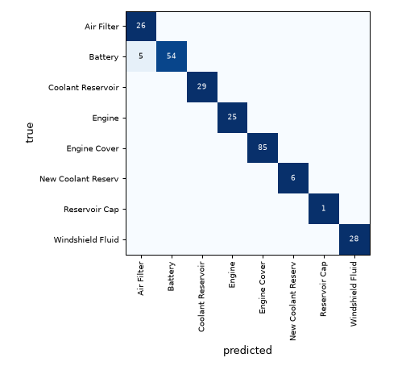
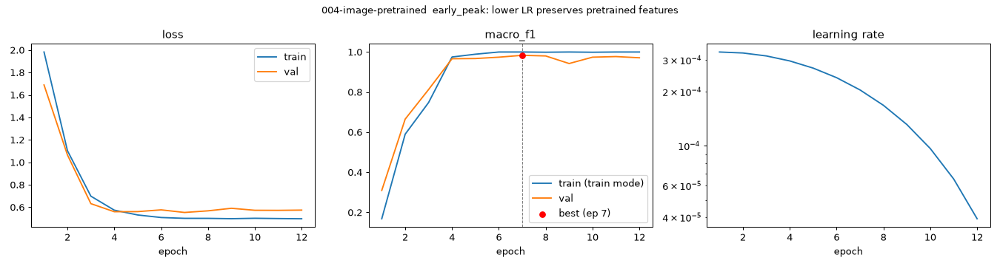

<h1 align="center">trainwright</h1>

<p align="center">
  <strong>Train, evaluate and ship small task-specific models, built to be driven by AI coding agents.</strong>
</p>

<p align="center">
  <a href="https://github.com/djcopp/trainwright/actions/workflows/ci.yml"></a>
  
  
  <a href="LICENSE"></a>
</p>

---

Many production LLM calls are narrow, repetitive jobs: routing a ticket, classifying a photo,
scoring a record. A model trained for that one task is often as accurate, hundreds to thousands of
times cheaper to run, and much faster.

trainwright is a PyTorch framework for building those models, built around the ML lifecycle.
In the spirit of PyTorch Lightning it standardises the training loop, data handling and
experiment tracking. Every command also works as a step an agent can follow: it returns
structured output, enforces the order of the lifecycle, diagnoses each run and proposes the next
experiment. That way a coding agent produces the same disciplined result a careful ML engineer would.

## Highlights

- **Opinionated lifecycle.** Profile, frozen split, baselines, hypothesis-driven experiments,
  a sealed test set, a production refit, export and a cost benchmark, all from one CLI.
- **Built-in leakage controls.** Duplicate- and near-duplicate-aware splits, detection of entity
  keys (users, sessions, assignments), and a test ledger that flags reuse.
- **Strong defaults per modality.** Tabular MLPs with periodic embeddings; fine-tuned or
  linear-probed vision backbones (ResNet, ConvNeXt, DINOv2); pretrained text encoders (bge, MiniLM).
- **Noise-aware decisions.** Bootstrap standard errors on every score, tie detection on the
  leaderboard, seed-spread reporting and greedy-weighted ensembles.
- **Plain-file experiment tracking.** Every run records its config, hypothesis, metrics, curves,
  diagnosis, git SHA, data fingerprint and split hash. No server required.
- **Deployable output.** Single-file ONNX bundles with a parity check, a torch-free runtime, a
  generated FastAPI server, Dockerfile and model card.
- **Agent integration.** A Claude Code skill, `AGENTS.md`, an MCP server, `--json` on every
  command and a `next:` hint after every step.
- **LLM distillation.** Label data with Claude under a spend cap, rank likely label errors and
  apply tracked corrections.

## Installation

```bash
uv add "trainwright[all]"
# or
pip install "trainwright[all]"
```

| extra | adds |
|---|---|
| `vision` | torchvision backbones and image I/O |
| `text` | Hugging Face encoders and tokenizers (bge, MiniLM, DINOv2) |
| `onnx`, `serve` | ONNX export and the FastAPI server |
| `label` | LLM labelling via the Anthropic API |
| `mcp` | Model Context Protocol server |

Requires Python 3.10+. CUDA, Apple Silicon (MPS) and CPU are detected automatically.

## Quickstart

```bash
trainwright init --data tickets.csv --target intent    # infer task, modality and metric
trainwright profile                                    # data checks and recommendations
trainwright split                                      # freeze train / val / test
trainwright baseline                                   # reference models on the same split
trainwright train --hypothesis "default recipe"        # first neural run
trainwright diagnose latest                            # findings and suggested next runs
trainwright evaluate best --split test --reason "final model"
trainwright finalize best                              # production model on all usable data
trainwright export <final-run> && trainwright benchmark <final-run>
```

Run `trainwright status` at any point to see where the project stands and what to do next.

## Using trainwright with coding agents

Install the agent instructions into a repository once:

```bash
trainwright agent-setup        # AGENTS.md, a CLAUDE.md import and a Claude Code skill
```

Then make requests in plain language:

> *We identify car parts in engine-bay photos with a Sonnet agent and it's getting expensive.
> The labelled photos are in `images/`. Can we train a smaller model that runs cheaply in the cloud?*

The skill gives the agent a playbook to follow, and each command's output tells it what to do
next. An abridged excerpt from a recorded session:

```text
$ trainwright profile
  * 67% of examples have a duplicate or near-duplicate (422 groups). The split keeps each group
    inside one split so scores are not inflated by near-copies.
$ trainwright train --hypothesis "default resnet18 recipe beats pixel baseline"
run 003-image-pretrained: best val_macro_f1=0.9704 at epoch 2/7
  - [warning] early_peak: validation got worse immediately after epoch 2. LR is likely too high.
$ trainwright train --from-run 003 -o optim.lr=0.000333 --hypothesis "lower LR preserves pretrained features"
#   run                         kind      val_macro_f1    params  time
1   004-image-pretrained        neural    0.9835 ±0.0072  11.18M  119s
2≈  003-image-pretrained        neural    0.9704 ±0.0244  11.18M  57s
3   002-baseline-pixels-linear  baseline  0.7307 ±0.0613  -       0s
$ trainwright evaluate best --split test --reason "final model"
004-image-pretrained on test (n=175): macro_f1=0.9955
$ trainwright benchmark 005-final-004-image-pretrained
cost per 1M predictions (estimate): small model $4.89 · claude-sonnet-5-5 $4,000
```

<p align="center">
  
  
</p>
<p align="center"></p>
<p align="center"><sub>Data: <a href="https://huggingface.co/datasets/stevenalbert10/Toyota-Corolla-Car-Parts">Toyota Corolla car parts</a> (Apache-2.0). Full walkthrough: <a href="examples/car_parts">examples/car_parts</a>.</sub></p>

To use it over MCP instead, register the server with `claude mcp add trainwright -- trainwright mcp`.

## Core concepts

| concept | what it means |
|---|---|
| **Project** | A directory with `trainwright.yaml`: data location, target, task, modality and the single primary metric. |
| **Frozen split** | Train / val / test fixed once, with a data fingerprint. Stratified, grouped or chronological. Duplicates never straddle splits. |
| **Run** | One training (or baseline, ensemble or production) job, stored under `runs/<id>/`, with its hypothesis and parent run. |
| **Diagnosis** | Automatic reading of the training curves: overfitting, non-convergence, instability, calibration, comparison with baselines. Each finding comes with concrete overrides. |
| **Sealed test set** | Model selection happens on val. Test is evaluated once per final model and every access is logged. |
| **Production model** | `finalize` retrains the chosen recipe on train + val (+ test once it has been scored). Its reported metrics are its parent run's held-out scores. |
| **Bundle** | The exported artefact: ONNX model(s), preprocessing state, runtime, server, Dockerfile and model card. |

## Command reference

| command | purpose |
|---|---|
| `init` | Create a project from a CSV/Parquet file, image folder or manifest. |
| `profile` | Types, missingness, leakage suspects, duplicates, entity keys, imbalance, recommendations. |
| `split` | Freeze the duplicate-aware train / val / test split. |
| `baseline` | Dummy, linear, gradient-boosting, TF-IDF or pixel baselines on the same split. |
| `train` | Train a model; `--from-run` and `-o key=value` for controlled follow-ups. |
| `diagnose` | Curve diagnosis with ready-to-run next experiments. |
| `tune` | Successive-halving search around the best recipe. |
| `ensemble` | Greedy-weighted ensemble of top runs, optionally with seed replicas. |
| `features` | Permutation feature importance on val (tabular). |
| `runs`, `show`, `status` | Leaderboard with standard errors, run details, lifecycle checklist. |
| `evaluate` | Error analysis on val, or the one-time final evaluation on test. |
| `finalize` | Retrain the chosen run on all usable data. |
| `export`, `serve`, `predict` | Build the deployable bundle, serve it, or predict files with it. |
| `benchmark` | Latency, throughput and cost per million predictions compared with an LLM call. |
| `label`, `review` | Label with an LLM under a spend cap; rank and correct likely label errors. |
| `report` | Write `reports/REPORT.md` covering data, experiments, evaluation and cost. |
| `models`, `schema`, `guide`, `agent-setup`, `mcp` | Model catalogue, config schema, agent playbook, agent files, MCP server. |

Every command accepts `--json`. `trainwright <command> --help` lists all options.

## Configuration

`trainwright init` writes a validated `trainwright.yaml`:

```yaml
name: tickets
task: classification          # or regression
modality: text                # tabular | image | text
data:
  path: tickets.csv
  target: intent
  text_column: message
  drop: []                    # columns never used as features
  group_column: null          # keep entities in one split
  time_column: null           # chronological split
split: {strategy: auto, val: 0.15, test: 0.15, seed: 42, dedup: true}
metric: macro_f1
metric_mode: max
cost:                         # assumptions used by `benchmark`
  instance_usd_per_hour: 0.05
  llm_name: claude-sonnet-5-5
  llm_usd_per_mtok_input: 2.0
  llm_usd_per_mtok_output: 10.0
```

Experiment settings use per-modality defaults and are overridden per run, for example
`-o optim.lr=3e-4 -o model.params.backbone=dinov2_small`. Unknown keys are rejected.
`trainwright schema` prints every option.

## Extending

**Feature engineering.** Put a `features.py` next to `trainwright.yaml`. It is fitted on the
train split only, applied everywhere (including baselines and serving), and versioned with each run.

```python
import pandas as pd

def fit(train: pd.DataFrame) -> dict:
    return {"store_mean": train.groupby("store")["basket"].mean().to_dict()}

def transform(df: pd.DataFrame, state: dict) -> pd.DataFrame:
    df = df.copy()
    df["store_mean"] = df["store"].map(state["store_mean"])
    return df
```

**Custom architectures.** Register a module in the project's `models.py`, then train it with
`-o model.name=my_net`:

```python
import torch
import trainwright as tw

@tw.register_model("my_net", modality="tabular", recipe={"optim.lr": 3e-3})
class MyNet(torch.nn.Module):
    def __init__(self, spec, hidden=128):
        super().__init__()
        self.net = torch.nn.Sequential(
            torch.nn.Linear(spec["n_num"], hidden), torch.nn.ReLU(), torch.nn.Linear(hidden, spec["n_outputs"])
        )

    def forward(self, x_num, x_cat):
        return self.net(x_num)
```

## Deployment

```text
artifacts/<run>/
├── model.onnx            # or one sub-bundle per member for ensembles
├── bundle.json           # preprocessing state, classes, metrics, provenance
├── tw_runtime/           # numpy + onnxruntime inference, no torch
├── server.py             # FastAPI: /health, /metadata, /predict
├── Dockerfile
├── requirements.txt
└── MODEL_CARD.md
```

```bash
trainwright serve <run>                      # local server
docker build -t my-model artifacts/<run>     # container
trainwright predict <run> -i new.csv --out predictions.csv
```

`trainwright benchmark` reports latency, model-only and end-to-end throughput, and estimated
cost per million predictions against the LLM call being replaced, printing every assumption it uses.

## Python API

The training primitives can be used directly:

```python
import trainwright as tw

task = tw.ClassificationTask(MyNet(), n_classes=10)
train = tw.TensorLoader({"x": x_train, "y": y_train}, batch_size=64, shuffle=True)
val = tw.TensorLoader({"x": x_val, "y": y_val}, batch_size=256)

trainer = tw.Trainer(max_epochs=30, monitor="val_accuracy", mode="max", patience=5)
result = trainer.fit(task, train, val)
```

Batches are dictionaries: `"y"` is the target and every other key is passed to `forward` as a
keyword argument.

## Benchmarks

trainwright is evaluated with an A/B harness. Claude Code receives the same request on public
datasets, once with only a standard Python ML environment (the straight prompt) and once with
trainwright. Both are scored on a 15% holdout neither agent ever sees, with two or more runs per
condition.

<!-- RESULTS_TABLE -->

Method, per-round results and the changes each round produced are documented in
[docs/agent-trials.md](docs/agent-trials.md). Reproduce with `bench/agent_trials.py`.

## Limitations

- Single-machine training; no distributed or multi-GPU support.
- Classification and regression only: no detection, segmentation, multi-label or generation.
- Cost figures are estimates derived from the assumptions in `trainwright.yaml`.
- The agent benchmark covers four datasets with a few runs per condition. It shows behaviour,
  not a statistical guarantee.

## Development

```bash
uv sync --all-extras
uv run pytest                         # unit and end-to-end tests for every modality
uv run ruff check src tests && uv run mypy src
```

Contributions are welcome. Please open an issue to discuss significant changes first.

## License

[Apache-2.0](LICENSE)
