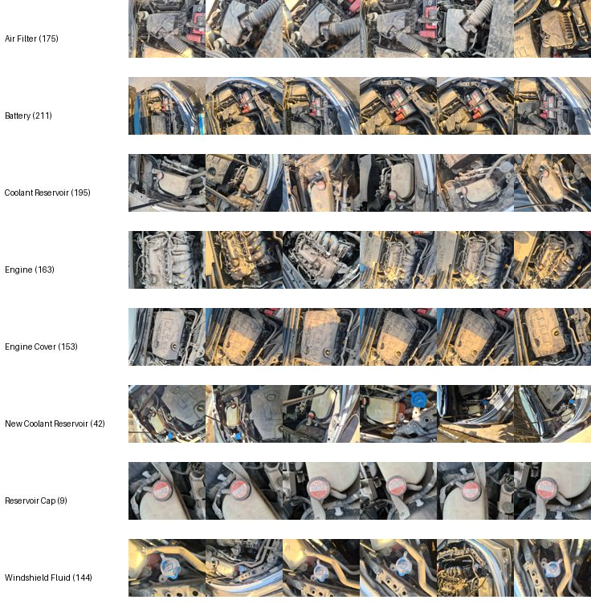

<h1 align="center">trainwright</h1>

<p align="center">
  <strong>Train, evaluate and ship small task-specific models, built to be driven by AI coding agents.</strong>
</p>

<p align="center">
  <a href="https://github.com/djcopp/trainwright/actions/workflows/ci.yml"></a>
  
  
  <a href="LICENSE"></a>
</p>

---

Routing a ticket, classifying a photo, scoring a record: narrow jobs that often run on an LLM
call. trainwright trains a small model for the job, checks it properly and packages it to serve.

## Results

**trainwright beats a vanilla prompt in 14 of 22 head-to-head runs: +2.6% on average, up to
+25%, and up to 60% fewer errors.**

Same request, same agent (Claude Code on Sonnet), with and without trainwright. Scored on a
hidden 15% holdout neither agent sees.

| task | data | metric | prompt only | with trainwright |
|---|---|---|---|---|
| hourly bike demand | [bike sharing](https://www.openml.org/d/42712), 17k rows | RMSE ↓ | 40.2 | **36.0** |
| star rating from review text | [app reviews](https://huggingface.co/datasets/sealuzh/app_reviews), 20k | RMSE ↓ | 1.081 | **0.973** |
| reading relevance | [eye movements](https://www.openml.org/d/1044), 11k | accuracy | 0.802 | **0.870** |
| land use from satellite tiles | [EuroSAT](https://huggingface.co/datasets/blanchon/EuroSAT_RGB), 27k images | accuracy | 0.965 | **0.986** |
| customer churn | [telco churn](https://www.openml.org/d/42178), 7k | accuracy | 0.781 | **0.791** |
| test-bench time, 377 columns | [Mercedes](https://www.openml.org/d/42570), 4.2k | RMSE ↓ | 8.32 | **8.25** |
| particle signal vs background | [MiniBooNE](https://www.openml.org/d/41150), 130k | accuracy | 0.946 | **0.953** |
| leaf disease | [beans](https://huggingface.co/datasets/AI-Lab-Makerere/beans), 1.3k images | accuracy | **0.952** | 0.949 |
| irony in tweets | [tweet_eval](https://huggingface.co/datasets/cardiffnlp/tweet_eval), 4.6k | accuracy | **0.761** | 0.749 |
| car-part photos | [car parts](https://huggingface.co/datasets/stevenalbert10/Toyota-Corolla-Car-Parts), 1.4k images | accuracy | **0.996** | 0.981 |
| superconductor temperature | [superconduct](https://www.openml.org/d/44148), 21k | RMSE ↓ | **9.88** | 10.04 |
| support intent, 77 classes | [banking77](https://huggingface.co/datasets/PolyAI/banking77), 13k | accuracy | **0.934** | 0.893 |

- **Head-to-head:** each prompt-only run against the trainwright run on the same task, 22 pairs
  over 12 tasks: 14 wins, 1 tie, 7 losses. Best: eye movements, 0.696 → 0.870 (+25%).
- **Fewer errors:** EuroSAT misclassifies 1.4% of tiles instead of 3.5% (−60%); eye movements −34%,
  MiniBooNE −13%, bike-demand RMSE −10.5%.
- **Wins are bigger than losses:** +4.9% on average when ahead, −1.9% when behind.
- **More consistent:** the same prompt-only request scored 0.908 and 0.696 on eye movements;
  trainwright scored 0.859 and 0.848 (round 5).

Per task against the prompt-only mean (the table): 7 of 12, +2.1%. trainwright 0.5.2, one run per
task. Three of the four losses trace to failures fixed in 0.5.4 (a hung step, a tie broken by run
order, unused budget); tweet_irony is within noise. Details: [docs/agent-trials.md](docs/agent-trials.md).

Without an agent, the automated pipeline against early-stopped gradient boosting on
OpenML-CC18 + CTR23 (sealed test sets, v0.4.2):

| datasets | matches or beats | strictly better | mean gain | median classification-error cut |
|---|---|---|---|---|
| 98 | **88** | 63 | +4.9% | 4.8% |

## What it looks like

```text
$ trainwright init --data mercedes.csv --target y
$ trainwright auto --budget 8m                     # abridged
[auto 7.1s] profiled data; dropped id-like/constant columns: X11, X93, X95, X107, X207 +12 more
[auto 7.4s] froze random split {'train': 2504, 'val': 537, 'test': 537}
[auto 1.3m] baselines: dummy, linear, hist_gbm
[auto 1.6m] mlp: val_rmse=8.9667 in 8.8s
[auto 1.7m] mlp-plain: val_rmse=8.6597 in 4.0s
[auto 4.0m] tune: 11 trials in 2.6m; best neural now 009-tune-r1-t3 val_rmse=8.3662
[auto 4.8m] trained 4 seed replica(s) of 009-tune-r1-t3
[auto 4.8m] ensemble ensemble[4]: val_rmse=8.0525
[auto 5.2m] finalized 021-ensemble on train+val -> 026-final-021-ensemble

#   run                    kind      val_rmse         params
1   021-ensemble           ensemble  8.0525 ±0.4744   -
2≈  003-baseline-hist-gbm  baseline  8.2725 ±0.4803   -
3≈  019-seed3-009-tune...  neural    8.2949 ±0.4689   0.31M
≈ = within 2 standard errors of #1: the difference is likely noise

$ trainwright evaluate best --split test --reason "final model"
$ trainwright predict -i holdout.csv --out predictions.csv --columns prediction
```

<p align="center">
  
</p>

## Install

```bash
uv add "trainwright[all]"        # or: pip install "trainwright[all]"
```

| extra | adds |
|---|---|
| `vision` | torchvision backbones, image I/O |
| `text` | Hugging Face encoders (bge, roberta, MiniLM, DINOv2) |
| `onnx`, `serve` | ONNX export, FastAPI server |
| `label` | LLM labelling (Anthropic API) |
| `mcp` | MCP server |

| hardware | training | mixed precision | serving |
|---|---|---|---|
| NVIDIA GPU | `cuda` (`train.device=cuda:1` to pick) | bf16 (Ampere+), else fp16 + grad scaling | CUDA provider with `onnxruntime-gpu` |
| AMD GPU (ROCm PyTorch) | `cuda` | as above | ROCm provider if available |
| Apple Silicon | `mps` | bf16 above 5M params | CPU |
| CPU | `cpu` | fp32 | CPU |

Budgets adapt to the machine: a slower one trains fewer epochs on a compressed LR schedule.
Single device; no multi-GPU.

## With a coding agent

```bash
trainwright agent-setup        # AGENTS.md, a CLAUDE.md import, a Claude Code skill
```

> *We identify car parts in engine-bay photos with a Sonnet agent and it's getting expensive.
> The labelled photos are in `images/`. Can we train a smaller model that runs cheaply in the cloud?*

```text
$ trainwright profile
  * 67% of examples have a duplicate or near-duplicate (422 groups). The split keeps each group
    inside one split so scores are not inflated by near-copies.
$ trainwright train --hypothesis "default resnet18 recipe beats pixel baseline"
run 003-image-pretrained: best val_macro_f1=0.9704 at epoch 2/7
  - [warning] early_peak: validation got worse immediately after epoch 2. LR is likely too high.
$ trainwright train --from-run 003 -o optim.lr=0.000333 --hypothesis "lower LR preserves pretrained features"
#   run                         kind      val_macro_f1    params  time
1   004-image-pretrained        neural    0.9835 ±0.0072  11.18M  119s
2≈  003-image-pretrained        neural    0.9704 ±0.0244  11.18M  57s
3   002-baseline-pixels-linear  baseline  0.7307 ±0.0613  -       0s
$ trainwright evaluate best --split test --reason "final model"
004-image-pretrained on test (n=175): macro_f1=0.9955
$ trainwright benchmark 005-final-004-image-pretrained
cost per 1M predictions (estimate): small model $4.89 · claude-sonnet-5-5 $4,000
```

<sub>Recorded session (v0.4, abridged).</sub>

<p align="center">
  
  
</p>
<p align="center"><sub>Data: <a href="https://huggingface.co/datasets/stevenalbert10/Toyota-Corolla-Car-Parts">Toyota Corolla car parts</a> (Apache-2.0). Walkthrough: <a href="examples/car_parts">examples/car_parts</a>.</sub></p>

MCP instead of the CLI: `claude mcp add trainwright -- trainwright mcp`.

## Commands

| command | does |
|---|---|
| `init` | project from a CSV/Parquet file, image folder or manifest |
| `profile` | types, leaks (incl. sum-of-columns), duplicates, entity keys; dates and free text become features |
| `auto`, `wait` | the whole search on a budget, finalized; `--background` + `wait` for long budgets |
| `split`, `baseline`, `train`, `tune`, `bag`, `ensemble` | the individual search steps |
| `diagnose`, `features`, `runs`, `show`, `status` | curve diagnosis, feature importance, leaderboard (±SE), run details, checklist |
| `evaluate` | val error analysis, or the logged one-time test evaluation |
| `finalize` | refit the chosen run on train+val |
| `export`, `serve`, `predict`, `benchmark` | ONNX bundle, server, batch predictions (GPU via torch when available), cost vs the LLM |
| `label`, `review` | LLM labels under a spend cap; likely label errors |
| `report`, `models`, `schema`, `agent-setup`, `mcp` | report, model catalogue, config schema, agent files, MCP server |

Every command takes `--json` and prints `next:` suggestions.

## Configuration

```yaml
# trainwright.yaml (written by `init`, validated; unknown keys are rejected)
name: tickets
task: classification          # or regression
modality: text                # tabular | image | text
data:
  path: tickets.csv
  target: intent
  text_column: message
  drop: []                    # never used as features
  group_column: null          # entities stay in one split
  time_column: null           # chronological split
  date_columns: {}            # filled by `profile`
  text_features: []           # free-text columns in tables, filled by `profile`
split: {strategy: auto, val: 0.15, test: 0.15, seed: 42, dedup: true}
metric: macro_f1
```

Per-run overrides: `-o optim.lr=3e-4 -o model.params.backbone=dinov2_small`. All options: `trainwright schema`.

## Extending

```python
# features.py: fitted on train only, applied everywhere (baselines, serving), versioned per run
def fit(train):
    return {"store_mean": train.groupby("store")["basket"].mean().to_dict()}

def transform(df, state):
    return df.assign(store_mean=df["store"].map(state["store_mean"]))
```

```python
# models.py: then `trainwright train -o model.name=my_net`
import torch, trainwright as tw

@tw.register_model("my_net", modality="tabular", recipe={"optim.lr": 3e-3})
class MyNet(torch.nn.Module):
    def __init__(self, spec, hidden=128):
        super().__init__()
        self.net = torch.nn.Sequential(
            torch.nn.Linear(spec["n_num"], hidden), torch.nn.ReLU(), torch.nn.Linear(hidden, spec["n_outputs"])
        )

    def forward(self, x_num, x_cat):
        return self.net(x_num)
```

```python
# the training loop on its own: batches are dicts, "y" is the target, other keys go to forward()
task = tw.ClassificationTask(Net(), n_classes=10)
train = tw.TensorLoader({"x": x_train, "y": y_train}, batch_size=64, shuffle=True)
val = tw.TensorLoader({"x": x_val, "y": y_val}, batch_size=256)
tw.Trainer(max_epochs=30, monitor="val_accuracy", mode="max", patience=5).fit(task, train, val)
```

## Deployment

```text
artifacts/<run>/
├── model.onnx        # parity-checked; one sub-bundle per member for ensembles
├── bundle.json       # preprocessing state, classes, metrics, provenance
├── tw_runtime/       # numpy + onnxruntime, no torch
├── server.py         # FastAPI: /health, /metadata, /predict
├── Dockerfile
└── MODEL_CARD.md
```

```bash
trainwright serve <run>
docker build -t my-model artifacts/<run>
```

## Limitations

- Classification and regression only.
- Cost figures are estimates from the `cost:` assumptions in `trainwright.yaml`.
- The agent comparison is 12 tasks with 1–2 runs per side: differences under ~1% are noise.

## Development

```bash
uv sync --all-extras
uv run pytest && uv run ruff check src tests && uv run mypy src
```

Benchmarks: `bench/agent_trials.py` (agent A/B), `bench/suite.py` (OpenML suites), `bench/variants.py` (recipe comparisons).

## License

[Apache-2.0](LICENSE)
