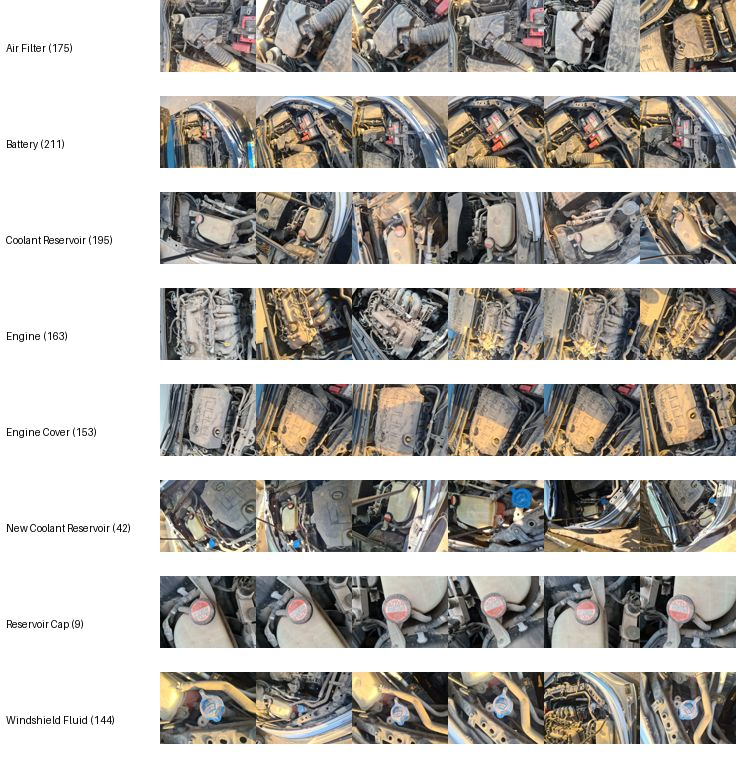
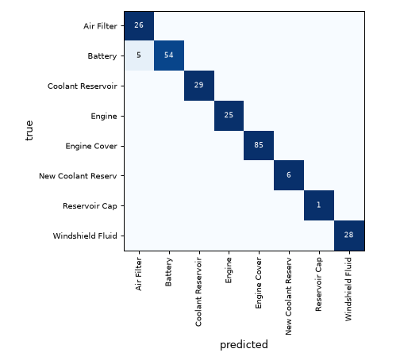

# Reference

Everything the [README](../README.md) leaves out: install options, hardware, commands, configuration, extending and deployment.

## Install

```bash
uv add "trainwright[all] @ git+https://github.com/djcopp/trainwright"   # or the same with pip install
```

| extra | adds |
|---|---|
| `vision` | torchvision backbones, image I/O |
| `text` | Hugging Face encoders (bge, roberta, MiniLM, DINOv2) |
| `onnx`, `serve` | ONNX export, FastAPI server |
| `label` | LLM labelling (Anthropic API) |
| `mcp` | MCP server |

| hardware | training | mixed precision | serving |
|---|---|---|---|
| NVIDIA GPU | `cuda` (`train.device=cuda:1` to pick) | bf16 (Ampere+), else fp16 + grad scaling | CUDA provider with `onnxruntime-gpu` |
| AMD GPU (ROCm PyTorch) | `cuda` | as above | ROCm provider if available |
| Apple Silicon | `mps` | bf16 above 5M params | CPU |
| CPU | `cpu` | fp32 | CPU |

Budgets adapt to the machine: a slower one trains fewer epochs on a compressed LR schedule.
Single device; no multi-GPU.

## A recorded agent session

```bash
trainwright agent-setup        # AGENTS.md, a CLAUDE.md import, a Claude Code skill
```

> *We identify car parts in engine-bay photos with a Sonnet agent and it's getting expensive.
> The labelled photos are in `images/`. Can we train a smaller model that runs cheaply in the cloud?*

```text
$ trainwright profile
  * 67% of examples have a duplicate or near-duplicate (422 groups). The split keeps each group
    inside one split so scores are not inflated by near-copies.
$ trainwright train --hypothesis "default resnet18 recipe beats pixel baseline"
run 003-image-pretrained: best val_macro_f1=0.9704 at epoch 2/7
  - [warning] early_peak: validation got worse immediately after epoch 2. LR is likely too high.
$ trainwright train --from-run 003 -o optim.lr=0.000333 --hypothesis "lower LR preserves pretrained features"
#   run                         kind      val_macro_f1    params  time
1   004-image-pretrained        neural    0.9835 ±0.0072  11.18M  119s
2≈  003-image-pretrained        neural    0.9704 ±0.0244  11.18M  57s
3   002-baseline-pixels-linear  baseline  0.7307 ±0.0613  -       0s
$ trainwright evaluate best --split test --reason "final model"
004-image-pretrained on test (n=175): macro_f1=0.9955
$ trainwright benchmark 005-final-004-image-pretrained
cost per 1M predictions (estimate): small model $4.89 · claude-sonnet-5-5 $4,000
```

<sub>Recorded session (v0.4, abridged).</sub>

<p align="center">
  
  
</p>
<p align="center"><sub>Data: <a href="https://huggingface.co/datasets/stevenalbert10/Toyota-Corolla-Car-Parts">Toyota Corolla car parts</a> (Apache-2.0). Walkthrough: <a href="../examples/car_parts">examples/car_parts</a>.</sub></p>

MCP instead of the CLI: `claude mcp add trainwright -- trainwright mcp`.

## Commands

| command | does |
|---|---|
| `init` | project from a CSV/Parquet file, image folder or manifest; `--masks DIR` for segmentation |
| `profile` | types, leaks (incl. sum-of-columns), duplicates, entity keys; dates and free text become features |
| `auto`, `wait` | the whole search, finalized; runs until new rounds stop improving (`--budget` for a hard ceiling); `--background` + `wait` |
| `check`, `decide` | the definition of done, read from the project's records; record judgement calls for reviewers |
| `split`, `baseline`, `train`, `tune`, `bag`, `ensemble` | the individual search steps |
| `errors`, `try` | where the model is wrong, plus self-built candidate features; test a feature idea in seconds |
| `diagnose`, `features`, `runs`, `show`, `status` | curve diagnosis, feature importance, leaderboard (±SE), run details, checklist |
| `evaluate` | val error analysis, or the logged one-time test evaluation |
| `finalize` | refit the chosen run on train+val |
| `export`, `serve`, `predict`, `benchmark` | ONNX bundle, server, batch predictions (GPU via torch when available), cost vs the LLM |
| `label`, `review` | LLM labels under a spend cap; likely label errors |
| `report`, `models`, `schema`, `agent-setup`, `mcp` | report, model catalogue, config schema, agent files, MCP server |

Every command takes `--json` and prints `next:` suggestions.

## Configuration

```yaml
# trainwright.yaml (written by `init`, validated; unknown keys are rejected)
name: tickets
task: classification          # or regression
modality: text                # tabular | image | text
data:
  path: tickets.csv
  target: intent
  text_column: message
  drop: []                    # never used as features
  group_column: null          # entities stay in one split
  time_column: null           # chronological split
  date_columns: {}            # filled by `profile`
  text_features: []           # free-text columns in tables, filled by `profile`
split: {strategy: auto, val: 0.15, test: 0.15, seed: 42, dedup: true}
metric: macro_f1
```

Per-run overrides: `-o optim.lr=3e-4 -o model.params.backbone=dinov2_small`. All options: `trainwright schema`.

## Extending

```python
# features.py: fitted on train only, applied everywhere (baselines, serving), versioned per run
def fit(train):
    return {"store_mean": train.groupby("store")["basket"].mean().to_dict()}

def transform(df, state):
    return df.assign(store_mean=df["store"].map(state["store_mean"]))
```

```python
# models.py: then `trainwright train -o model.name=my_net`
import torch, trainwright as tw

@tw.register_model("my_net", modality="tabular", recipe={"optim.lr": 3e-3})
class MyNet(torch.nn.Module):
    def __init__(self, spec, hidden=128):
        super().__init__()
        self.net = torch.nn.Sequential(
            torch.nn.Linear(spec["n_num"], hidden), torch.nn.ReLU(), torch.nn.Linear(hidden, spec["n_outputs"])
        )

    def forward(self, x_num, x_cat):
        return self.net(x_num)
```

```python
# the training loop on its own: batches are dicts, "y" is the target, other keys go to forward()
task = tw.ClassificationTask(Net(), n_classes=10)
train = tw.TensorLoader({"x": x_train, "y": y_train}, batch_size=64, shuffle=True)
val = tw.TensorLoader({"x": x_val, "y": y_val}, batch_size=256)
tw.Trainer(max_epochs=30, monitor="val_accuracy", mode="max", patience=5).fit(task, train, val)
```

## Deployment

```text
artifacts/<run>/
├── model.onnx        # parity-checked; one sub-bundle per member for ensembles
├── bundle.json       # preprocessing state, classes, metrics, provenance
├── tw_runtime/       # numpy + onnxruntime, no torch
├── server.py         # FastAPI: /health, /metadata, /predict
├── Dockerfile
└── MODEL_CARD.md
```

```bash
trainwright serve <run>
docker build -t my-model artifacts/<run>
```

## Limitations

- Classification, regression and semantic segmentation. Segmentation models aren't ensembled yet.
- Cost figures are estimates from the `cost:` assumptions in `trainwright.yaml`.
- The agent comparison is 12 tasks with 1–2 runs per side: differences under ~1% are noise. Method and every result: [agent-trials.md](agent-trials.md).

## Development

```bash
uv sync --all-extras
uv run pytest && uv run ruff check src tests && uv run mypy src
```

Benchmarks: `bench/agent_trials.py` (agent A/B), `bench/suite.py` (OpenML suites), `bench/variants.py` (recipe comparisons).
